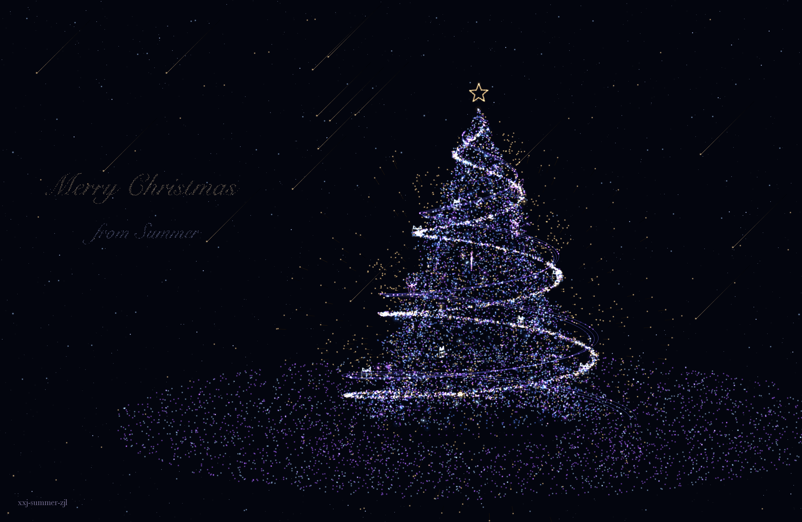
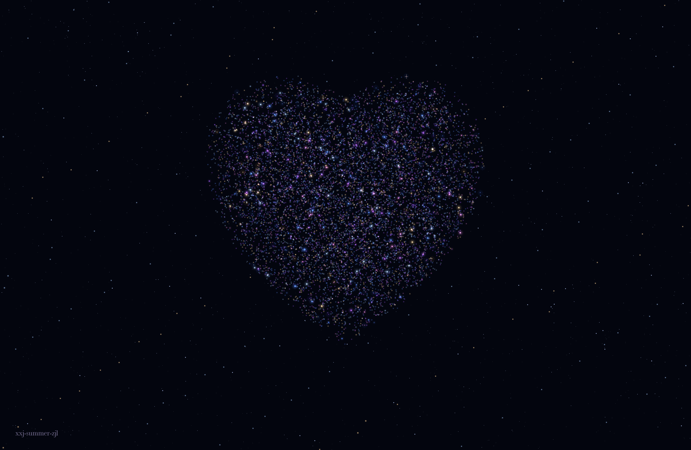
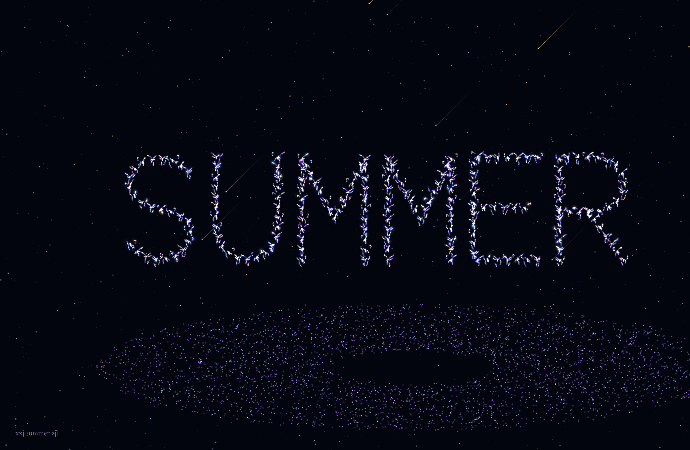

# Blue Hour Christmas · Summer 的手势星树

一段在 macOS 上运行的 Python 粒子动画。使用电脑内置摄像头，用一只手让星尘依次组成爱心、数字、圣诞树，以及由粒子蝴蝶组成的 **SUMMER**。



## 安装和运行

需要 macOS、Python 3.14、摄像头与首次安装时的网络连接。项目使用系统自带的 Snell Roundhand 字体。

```bash
python3.14 -m venv .venv
.venv/bin/python -m pip install -r requirements.txt
.venv/bin/python setup_model.py
.venv/bin/python celestial.py
```

也可以双击 `启动星河圣诞树.command`，它会完成首次安装并启动程序。系统第一次询问时请允许摄像头权限。手势模型来自 Google MediaPipe，首次运行通过 `setup_model.py` 下载并校验，不保存在本仓库。

## 单手交互

开场张开手掌并保持约半秒，粒子聚成爱心。依次比出 1、2、3，每个手势保持约半秒。握拳让粒子收成光核，再张开手掌让它变成圣诞树。

成树后，握拳缩小，张掌放大，伸出食指画圈旋转。快速左右或上下挥手，树散成星尘和粒子蝴蝶，再拼成 **SUMMER**。继续移动手掌，整个名字随手移动，停手后重新聚成树。

键盘按 `R` 重来，按 `F` 全屏，按 `Esc` 退出。无摄像头时可用 `0 → 1 → 2 → 3 → X → 0` 依次演示，鼠标拖动旋转，滚轮缩放。




## 验证

```bash
.venv/bin/python -m unittest discover -s tests -q
SDL_VIDEODRIVER=dummy .venv/bin/python celestial.py --smoke-test
```

源码采用 MIT 许可。运行时下载的手势模型由 Google MediaPipe 提供，遵循其自身的许可。
